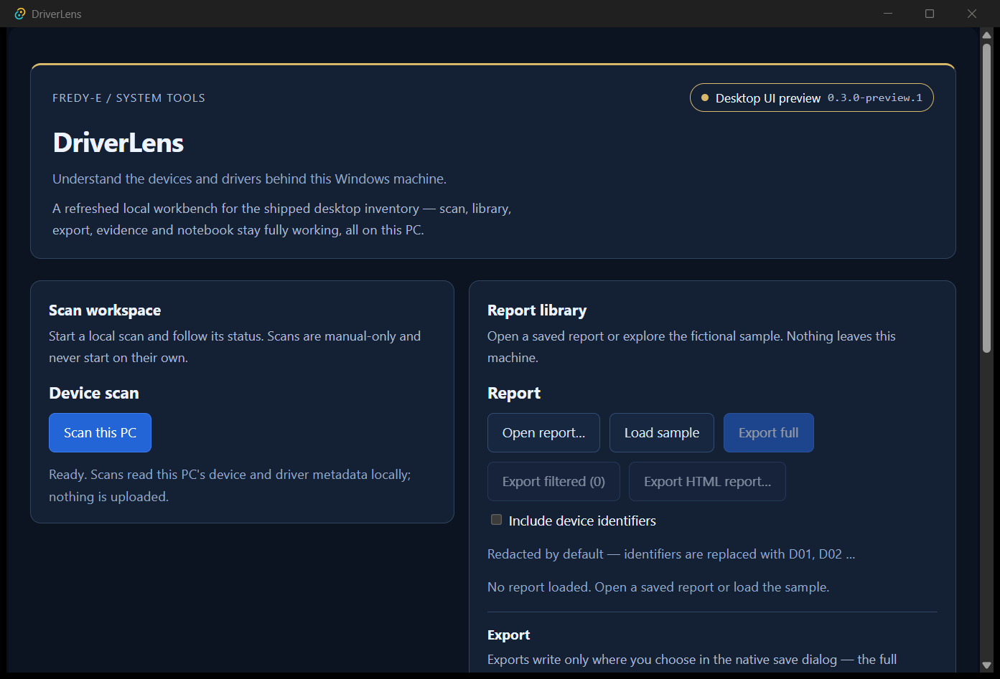

# Desktop UI preview 0.3.0-preview.1 — verification

**Experimental prerelease; local verification on 2026-10-13.** The preceding
missing-MSVC/SDK note described the 2026-10-12 draft and is superseded by this
actual build/test record. Dated v0.1.0/v0.2.0 records and releases remain history.

## What ran

- Supported Microsoft ARM64 C++/Windows SDK environment verified with an actual
  ARM64 compile and successful executable run, not merely installer exit.
- `cargo check --locked --offline --all-targets`; 106 Rust tests (92 unit and
  14 IPC-boundary integration); real harmless PowerShell acceptance included.
- 233 frontend tests, TypeScript check, Vite production build and 7 bundle checks.
- Separate feature-gated native E2E build: all 15 WebView/IPC cases passed,
  zero skips or app console errors; fake pickers/scripted collectors and an
  isolated test notebook. Initial stale-badge assertion failure retained;
  only the test assertion changed, then the entire native suite was rerun.
- Production EXE launched from an isolated copy: real DriverLens window and
  owned WebView2 children; zero startup collectors/listening TCP sockets;
  normal close left no owned descendants. No scan or user notebook was opened.
- NSIS archive tested and extracted with 7-Zip, without executing the installer.
  Payload/resource bytes inspected; standard ASCII/LF checksums exercised with
  `sha256sum -c SHA256SUMS.txt`, all 6 listed assets passed.

## Current native capture

PrintWindow capture of the actual production binary on a locked Windows session,
not a renderer simulation or desktop/bystander screen capture. Default viewport
shows the startup workbench; lower sections are below the scroll fold. No owner
inventory or notebook data is shown. The functional E2E suite is separate.

## Artifact bytes

| Asset | Bytes | SHA-256 |
|---|---:|---|
| `DriverLens-0.3.0-preview.1-arm64-portable.exe` | 8236544 | `41165ad46cd1e6ee8b736ba6d082ba0314d8a5c509e438d66738ef28198865bc` |
| `DriverLens-0.3.0-preview.1-arm64-setup.exe` | 1949548 | `6b790af49d4ff128a6c3b1dfe2620893e0132973a2881321759b7a435726bc38` |
| `DriverLens-0.3.0-preview.1-arm64-portable.zip` | 2762618 | `5af08285d3adf290b61f851943171302c5ddb14be691565935ccfec86ae538f9` |
| `Collect-DriverLens.ps1` | 7670 | `4164867931de2b08ccc1c6ce9bd7389114aa15341f84dcc265e665651eaff32c` |
| `LICENSE` | 1064 | `118627d502b5354883f7ee30d86c6ae3073f74713e39fd33b02c451111d115e4` |
| `THIRD-PARTY-NOTICES.md` | 41321 | `4138b19c56ec19743d0e85b57a4d8f1352bd7784894ca1e63c45e6c5722d59bb` |

The app/installer payload is ARM64 (`0xAA64`); the NSIS stub is x86 (`0x014C`)
and runs under emulation. The extracted app SHA-256 is
`b5ff57de227e4fb5ce2a48fed983fd93fbc909f3c4cdea43eb5fed2297b5a3fe`.
Compared with the portable EXE, exactly three bytes differ: Tauri's
`VAR_UNK` → `VAR_NSS` bundle marker at offsets 6161506–6161508; every other
byte is identical. The bundled collector matches the reviewed source exactly.
Production executables contain none of the checked E2E marker/environment names.

A final raw-executable sweep found compiler-emitted local registry paths in the
first local build. It was superseded before any remote upload. Production and
feature builds were rebuilt with Rust path remapping; all 15 native cases and
production startup/close passed again. Both the portable and extracted installed
executables now have zero checked build-machine/workspace path strings in UTF-8
or UTF-16. The current artifact table above names only these remapped bytes.

## Running and limits

Prefer the portable ZIP: extract all files and keep `resources/Collect-DriverLens.ps1`
next to its executable in the `resources` directory. Copying just the EXE is not
complete live-collection distribution. WebView2 is required; PowerShell 7 is
required for manual collection. The installer may fetch WebView2 when absent.
Both binaries are unsigned; SmartScreen may warn. Read LICENSE and the separate
third-party notices (also inside the portable ZIP). Third-party lock entries and
desktop npm dependencies match v0.2.0 apart from first-party version metadata;
the previous license texts are retained with a provenance note.

No clean-machine install/upgrade/uninstall, missing-WebView2/SmartScreen behavior,
real inventory, x86/x64 hardware matrix, USB/vehicle or production readiness was
validated by this preview work. Synthetic tests are not those qualifications.
